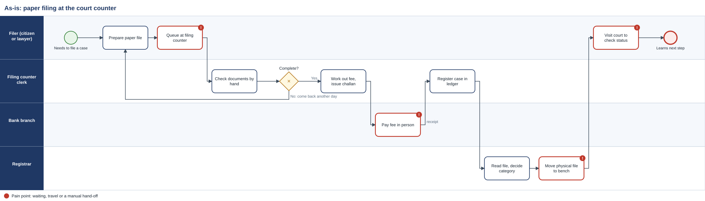
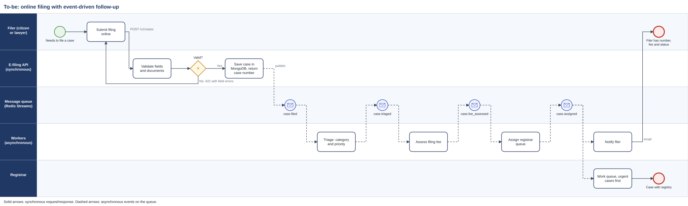

# Court E-Filing Event Pipeline

Filing a civil case on paper means queuing at a court counter, being sent home if one document is missing, paying the fee at a bank, and coming back to ask what happened. This project redesigns that process and builds the core of the replacement: an online filing API that gives the filer a case number in milliseconds, and event-driven workers that triage, price and route every case to the right registrar without anyone carrying a file down a corridor.

**New to this? Start with the [plain-language explainer (PDF)](docs/Project_Explained.pdf).**

It covers the full business analysis path, from process maps to running code:

| Deliverable | Where |
|---|---|
| Plain-language visual explainer | [`docs/Project_Explained.pdf`](docs/Project_Explained.pdf) |
| As-is and to-be swimlane process maps (SVG + BPMN 2.0) | [`docs/process/`](docs/process) |
| Requirements, user stories, acceptance criteria, NFRs, open questions | [`docs/requirements.md`](docs/requirements.md) |
| Data model, schema versioning, event contract, sync vs async | [`docs/data_model.md`](docs/data_model.md) |
| API contract (OpenAPI 3.1) | [`docs/openapi.json`](docs/openapi.json) |
| Traceability: requirement to story to process step to code to test | [`docs/traceability.csv`](docs/traceability.csv) |
| Working service: FastAPI + MongoDB + Redis Streams | [`app/`](app) |
| Acceptance tests, one per requirement, plus a traceability check | [`tests/`](tests) |

The scenario is fictional. Fees, categories and court names are illustrative.

## The process

**As-is.** Four of the steps (red) are waiting, travel or a manual hand-off.



**To-be.** The filer waits only for validation and a case number (solid arrows, synchronous). Everything else happens on the message queue (dashed arrows, asynchronous).



The diagrams are generated from one model in [`tools/build_diagrams.py`](tools/build_diagrams.py), so the SVG and the BPMN file never drift apart. Open the `.bpmn` files in [bpmn.io](https://demo.bpmn.io) or Camunda Modeler to edit them.

## How it works

```
Portal / app ──POST /v1/cases──> E-filing API ──save──> MongoDB (cases, audit_log, notifications)
                                     │
                                     └─publish case.filed──> Redis Stream "efiling.events"
                                                                 │  (one consumer group per worker)
                     ┌───────────────┬───────────────────┬───────┴──────────┐
                  triage          fees            assignment         notifications
              category, priority  filing fee     registrar queue     email outbox
                     └─ publishes the next event ─┘
```

- **MongoDB** holds each case as one document (parties, documents, status history), because a case is always read and written as a whole and its shape grows over time. Unique indexes stop duplicate case numbers and duplicate submissions.
- **Redis Streams** is the message queue. Each worker type is a consumer group, so you can run more instances and they share the load. Messages stay pending until acknowledged.
- **Nothing is lost.** A step that fails is retried up to 3 times, then parked on a dead-letter stream for a person to review. If Redis is down when a case is filed, the case is still saved, the filer still gets their number, and `scripts/republish.py` re-sends the event later.
- **Safe to repeat.** Delivery is at-least-once, so every worker checks the case status before acting, and `Idempotency-Key` stops a double-clicked submit from creating two cases.
- **Old data still works.** Records from schema v1 (claimant and respondent as plain strings) are upgraded on read to v2 (a parties list).

## Run it

**Quick demo, no setup** (in-memory MongoDB and Redis):
```bash
pip install -r requirements.txt
python -m scripts.demo
```
```
POST /v1/cases -> 201 CIV-2026-000001 (5 ms, filer waits only for this)
...
20 events on the queue, 80 deliveries across 4 workers

case             category    priority        fee  queue
CIV-2026-000001  property    standard      6,300  civil-registry-a
CIV-2026-000002  commercial  standard     39,500  commercial-registry
CIV-2026-000003  labour      standard          0  labour-registry
CIV-2026-000004  property    urgent        1,500  civil-registry-a
CIV-2026-000005  family      standard        500  family-registry
```

**Real services** (MongoDB 7, Redis 7, API, workers):
```bash
docker compose up --build
curl -X POST localhost:8000/v1/cases -H "Content-Type: application/json" -H "Idempotency-Key: demo-1" -d @- <<'EOF'
{"filer_type":"citizen","filer_email":"sana@example.com","summary":"Tenant has not paid rent for eight months and refuses to leave.",
 "claim_amount":480000,"parties":[{"name":"Sana Malik","role":"claimant"},{"name":"Imran Qureshi","role":"respondent"}],
 "documents":[{"title":"Plaint","kind":"plaint","pages":6}]}
EOF
curl localhost:8000/v1/cases/CIV-2026-000001
```
Interactive API docs: http://localhost:8000/docs

**Tests**
```bash
pytest -q
```
Each test is named after the requirement it proves (`test_req07_...`), and `test_traceability.py` fails if a requirement has no test or the matrix points at a test that doesn't exist.

## API

| Method | Path | Mode | Purpose |
|---|---|---|---|
| POST | `/v1/cases` | sync | Validate and save a filing; returns case number (201), or the same case for a repeated `Idempotency-Key` (200) |
| GET | `/v1/cases/{case_number}` | sync | Current status, category, fee, queue and history |
| GET | `/v1/registry/queues` | sync | Open cases per registrar queue and priority (MongoDB aggregation) |

Errors always look like this:
```json
{"code": "VALIDATION_FAILED", "message": "The filing is incomplete or has invalid fields.",
 "details": [{"field": "documents", "problem": "Value error, a plaint document is required"}]}
```

## What I'd do next

- Replace keyword triage with a text classifier trained on labelled past filings, keeping a confidence threshold below which a clerk decides.
- Add a payment service that listens for `case.fee_assessed` and publishes `case.fee_paid`, so assignment waits for payment.
- Measure the as-is process (visits, days to registration, rejection rate) before go-live, so the improvement can be proven, not assumed.

## Stack

Python 3.12, FastAPI, Pydantic, MongoDB (pymongo), Redis Streams (redis-py), pytest, Docker Compose, BPMN 2.0.
